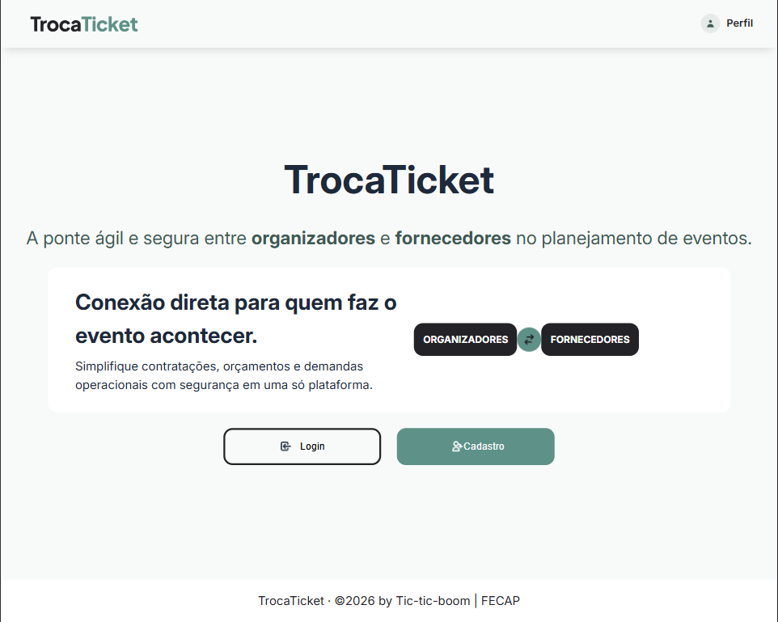

# FECAP - Fundação de Comércio Álvares Penteado

<p align="center">
<a href= "https://www.fecap.br/"></a>
</p>

# TrocaTicket

## Tic-tic-boom

## Integrantes: <a href="https://github.com/anacaoliv">Ana Clara Silva</a>, <a href="https://github.com/IanSdeArruda">Ian Bispo Sales</a>, <a href="https://github.com/mirwlli">Mirelli Pedro</a> e <a href="https://www.linkedin.com/in/sabrina-nascimento-dev/">Sabrina Santos</a>

## Professores Orientadores: <a href="https://www.linkedin.com/in/dolemes/">David Lemes</a>, <a href="https://www.linkedin.com/in/francisco-escobar/">Francisco Escobar</a>, <a href="https://www.linkedin.com/in/jesuslisboagomes/">Jésus Gomes</a>, <a href="https://www.linkedin.com/in/katia-bossi/">Kátia Bossi</a>, <a href="https://www.linkedin.com/in/paula-astorino-432b5812a/">Paula Astorino</a>

## Descrição

<p align="center">
 
</p>

<h3>O nosso propósito:</h3>
A Troca Ticket nasceu para descomplicar a produção de eventos, conectando quem organiza, quem presta serviços e quem administra tudo em uma única plataforma intuitiva.<br>

Em vez de lidar com dezenas de ferramentas e planilhas soltas, nossa visão é centralizar cada etapa da jornada em um só lugar: desde o cadastro de organizadores e fornecedores, com aprovações seguras e relatórios completos, até o envio e seleção de propostas de serviços em tempo real.
<br>

Na prática, o fluxo funciona de forma simples e direta. O organizador cadastra sua empresa, projeta os custos dos ingressos e escolhe os melhores fornecedores para o seu projeto.

Já os prestadores de serviço encontram oportunidades claras para enviar orçamentos detalhados e acompanhar suas propostas sem enrolação.

Tudo isso sob a supervisão do administrador, que garante a validação dos cadastros, o acompanhamento das métricas e a gestão transparente de todo o ecossistema.

## Links rápidos para acesso as entregas das disciplinas
<a href="documentos/Entrega 2/Cálculo II">Entrega Cálculo II</a><br>
<a href="documentos/Entrega 2/Gestão Empresarial">Entrega Gestão Empresarial</a><br>
<a href="documentos/Documento - Projeto de Extensão - COM Empresa - 2026_1.pdf">Entrega PI Programação Web</a><br>
<a href="documentos/Entrega 2/Projeto Banco de Dados">Entrega Projeto Banco de Dados</a><br>
<a href="documentos/Entrega 2/Web FullStack">Entrega Web FullStack</a><br>

## 🛠 Estrutura de pastas

-Raiz<br>
|<br>
|-->documentos<br>
  &emsp;|-->Entrega 1<br>
  &emsp;&emsp;|-->Cálculo II<br>
  &emsp;&emsp;|-->Gestão Empresarial<br>
  &emsp;&emsp;|-->PI - Programação Web<br>
  &emsp;&emsp;|-->Projeto Banco de Dados<br>
  &emsp;&emsp;|-->Web FullStack<br>
  &emsp;|-->Entrega 2<br>
  &emsp;&emsp;|-->Cálculo II<br>
  &emsp;&emsp;|-->Gestão Empresarial<br>
  &emsp;&emsp;|-->PI - Programação Web<br>
  &emsp;&emsp;|-->Projeto Banco de Dados<br>
  &emsp;&emsp;|-->Web FullStack<br>
  &emsp;|Documento - Projeto de Extensão - COM Empresa.docx<br>
|-->executáveis<br>
|-->imagens<br>
|-->src<br>
  &emsp;|-->Entrega 1<br>
  &emsp;&emsp;|-->Backend<br>
  &emsp;&emsp;|-->Frontend<br>
  &emsp;|-->Entrega 2<br>
  &emsp;&emsp;|-->Backend<br>
  &emsp;&emsp;|-->Frontend<br>
|readme.md<br>

## 🛠 Instalação

<b>HTML: (ainda não implementado)</b>

Não há instalação!
Encontre o index.html na pasta executáveis e execute-o como uma página WEB (através de algum browser).

## 💻 Configuração para Desenvolvimento

# Começar a desenvolver

Este guia descreve o fluxo básico para trabalhar na aplicação atual, localizada na pasta `src/Entrega 2`. A Entrega 1 é uma versão anterior do projeto.

## Pré-requisitos

- Git.
- Node.js em versão compatível com Vite 8 e npm.
- Acesso a uma instância PostgreSQL, local ou Supabase.

## 1. Obter o repositório

Clone o repositório e entre na pasta criada:

```powershell
git clone <url-do-repositorio>
Set-Location Projeto5
```

Se o repositório já estiver clonado, basta abrir a pasta raiz no VS Code.

## 2. Preparar o banco e o backend

O backend usa PostgreSQL. Configure uma instância e aplique, nessa ordem, os scripts SQL da pasta `src/Entrega 2/Backend/sql`:

1. `schema.sql` cria tabelas, tipos e regras do banco.
2. `seeds.sql` insere dados de exemplo.

Na pasta do backend, crie seu arquivo local `.env` a partir do modelo:

```powershell
Set-Location "src\Entrega 2\Backend"
Copy-Item .env.example .env
```

Instale dependências e inicie a API:

```powershell
npm install
npm run dev
```

A API ficará disponível em `http://localhost:5000`. Para iniciar sem Nodemon, use `npm start`.

## 3. Preparar o frontend

Abra um segundo terminal e instale as dependências:

```powershell
Set-Location "src\Entrega 2\Frontend"
npm install
```

Inicie o servidor de desenvolvimento:

```powershell
npm run dev
```

Abra no navegador o endereço informado pelo Vite, normalmente `http://localhost:5173`. O frontend usa `http://localhost:5000` como URL padrão da API. Para apontar para outra instância, defina `VITE_API_URL` no ambiente local do frontend.

## 4. Fluxo de trabalho

- Faça alterações nas pastas da Entrega 2: `Frontend` para React/interface e `Backend` para API e acesso ao banco.
- Antes de alterar uma rota ou funcionalidade, confira a implementação relacionada e as regras do banco em `Backend/sql/schema.sql`.
- No frontend, páginas ficam em `Frontend/src/paginas`, componentes compartilhados em `Frontend/src/components`, serviços de API em `Frontend/src/servicos` e estilos em `Frontend/src/styles`.
- No backend, consulte `Backend/src/rotas`, `repositorios`, `validadores`, `middlewares` e `utilitarios`. As rotas disponíveis estão resumidas em `src/Entrega 2/Backend/README.md`.
- Preserve alterações existentes no diretório de trabalho e mantenha segredos apenas em arquivos locais ignorados pelo Git.
- Ao concluir uma mudança de frontend, execute o lint e o build. O projeto não possui script de testes automatizados configurado.

```powershell
Set-Location "src\Entrega 2\Frontend"
npm run lint
npm run build
```

Para alterações no backend, verifique a sintaxe dos arquivos JavaScript com `node --check <caminho-do-arquivo>` e valide o comportamento com o banco configurado quando aplicável.


## 📋 Licença/License
<a href="https://github.com/2026-2-NCC2/Projeto5">TrocaTicket</a> © 2026 by <a href="https://github.com/fecaphub">Ana Clara Silva; Ian Sales; Mirelli Pedro; Sabrina Santos; FECAP</a> is licensed under <a href="https://creativecommons.org/licenses/by/4.0/">CC BY 4.0</a>

## 🎓 Referências

Aqui estão as referências usadas no projeto.

1. <https://trocaticket.com.br/>
2. <https://www.gov.br/governodigital/pt-br/acessibilidade-e-usuario/vlibras/vlibras>
3. <https://colorsontheweb.com/color-accessibility/contrast-checker/>
4. <https://vispero.com/lp/color-contrast-checker/>
5. <https://www.toptal.com/developers/gitignore>

